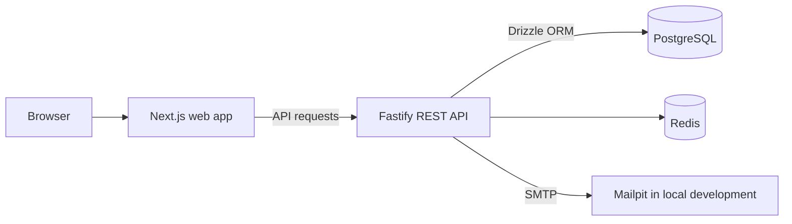

# This Project

This Project is a multi-tenant access management system for organizations that need to manage employee access across workspaces and products. Its planned resource hierarchy is **Organization -> Workspace -> Product**. Organization users administer the tenant, while each product has its own separate product users and product-scoped roles and permissions.

The current codebase focuses on organization onboarding, authentication, and organization-user management. Workspace and product capabilities are part of the roadmap; see the [task tracker](.ai-context/Task.md) for current implementation status and the [consolidated requirements](.ai-context/final_requirement.md) for the full product plan.

## Product model

- **SUPERADMIN** has full control over organization resources.
- **ADMIN** can manage permitted users and workspaces they created or where they are an invited workspace ADMIN.
- **MEMBER** can manage products and product users in workspaces where they have explicit membership.
- Workspace ADMINs have equal management rights. Products are shared within a workspace and have no individual owner.
- Product users are separate from organization users. Product roles and permissions are scoped to a single product.

These describe the intended product authorization model. Not all of these capabilities are implemented yet.

## Technology and architecture

- **Web:** Next.js, React, TypeScript, Tailwind CSS
- **API:** Node.js, TypeScript, Fastify
- **Database:** PostgreSQL with Drizzle ORM and SQL migrations
- **Session and one-time token storage:** Redis
- **Local email capture:** Mailpit
- **Local infrastructure:** Docker Compose



The web app uses Next.js route handlers and HTTP-only cookies for browser sessions. The API uses PostgreSQL for application data and Redis for session and one-time token state. In local development, Mailpit captures outgoing email and provides a web inbox at `http://localhost:8025`.

## Prerequisites

- Node.js and npm
- Docker with the Docker Compose plugin

## Local development

Run these commands from the repository root.

1. Install dependencies:

   ```bash
   npm install
   ```

2. Create local environment files from the examples:

   ```bash
   cp apps/api/.env.example apps/api/.env
   cp apps/web/.env.local.example apps/web/.env.local
   ```

   The example settings target the local Docker services. The API example includes development-only credentials and secrets; replace them before using any non-development environment.

3. Start PostgreSQL, Redis, and Mailpit:

   ```bash
   docker compose up -d
   ```

4. Apply the database migrations:

   ```bash
   npm run db:migrate --workspace=apps/api
   ```

5. Start the API and web app in separate terminals:

   ```bash
   npm run dev:api
   ```

   ```bash
   npm run dev:web
   ```

The web app is available at [http://localhost:3000](http://localhost:3000), the API at [http://localhost:4000](http://localhost:4000), and Mailpit at [http://localhost:8025](http://localhost:8025). The API health endpoints are `/healthz` and `/readyz`.

Docker Compose starts infrastructure only; run the API and web app with the npm commands above.

## Environment configuration

Use `apps/api/.env.example` and `apps/web/.env.local.example` as the complete local templates.

| File | Key settings | Purpose |
| --- | --- | --- |
| `apps/api/.env` | `DATABASE_URL`, `REDIS_URL` | PostgreSQL and Redis connections |
| `apps/api/.env` | `JWT_SECRET`, token TTL settings | API authentication and token lifetimes |
| `apps/api/.env` | `PORT`, `HOST`, `CORS_ORIGIN`, `WEB_APP_URL` | Local API and web app addresses |
| `apps/api/.env` | `SMTP_HOST`, `SMTP_PORT`, `SMTP_SECURE`, `MAIL_FROM` | Email delivery; defaults connect to local Mailpit |
| `apps/web/.env.local` | `NEXT_PUBLIC_API_URL` | API base URL used by the web app |

Do not commit `.env` or `.env.local` files. Keep production secrets outside source control.

## Useful commands

| Command | Description |
| --- | --- |
| `npm run dev:api` | Start the Fastify API in watch mode |
| `npm run dev:web` | Start the Next.js development server |
| `npm run build:api` | Build the API TypeScript project |
| `npm run build:web` | Build the web app |
| `npm run db:migrate --workspace=apps/api` | Apply pending Drizzle migrations |
| `npm run db:generate --workspace=apps/api` | Generate a migration from schema changes |
| `npm run test --workspace=apps/api` | Run the API test script |

## Current implementation

The API currently provides organization registration and email verification, initial password setup, login and token refresh/logout, and organization-user management. The web app includes onboarding, login, and organization-user screens. Organization roles and backend permission checks restrict user-management actions.

Workspace membership management, product administration, product-user integration, product-scoped roles and permissions, billing, and platform administration remain planned work. Consult `.ai-context/Task.md` before relying on roadmap behavior.

## Repository layout

```text
apps/
  api/       Fastify API, Drizzle schema and migrations
  web/       Next.js web application
.ai-context/ Product requirements, phase plans, and task status
docker-compose.yml  Local PostgreSQL, Redis, and Mailpit services
```

